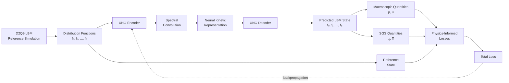
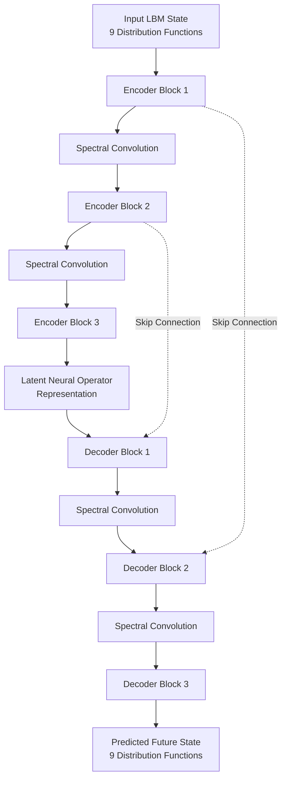
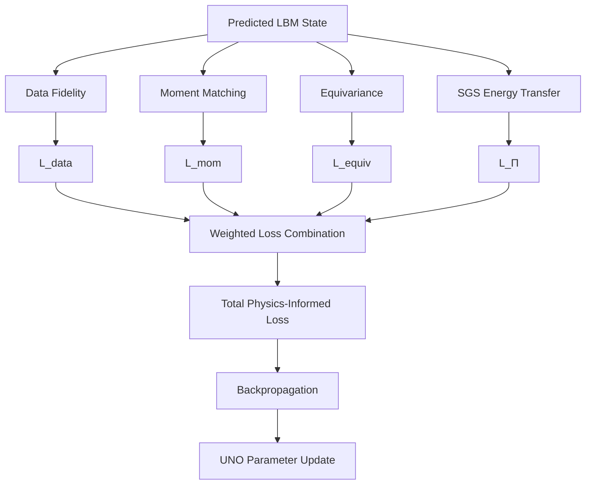
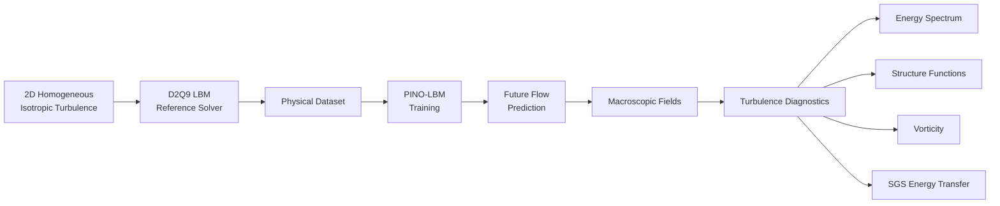
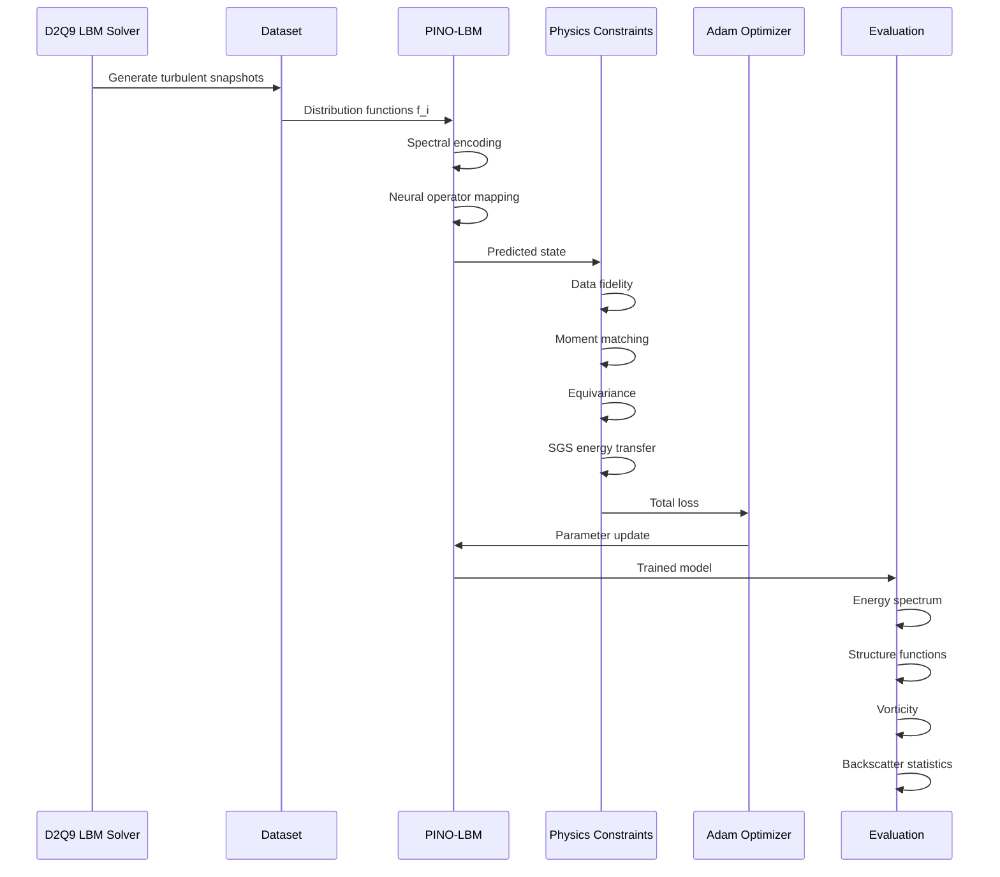
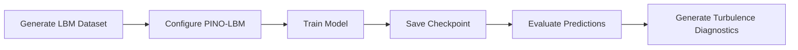

<div align="center">


# Physics-Informed Boltzmann Kinetic Learning for Subgrid-Scale Turbulence Modeling

### PINO-LBM

A unified physics-informed neural-kinetic framework for  
subgrid-scale turbulence modeling within the Lattice Boltzmann Framework.

<br>


</div>

---

# Overview

This repository contains the complete **PyTorch implementation** of the unified physics-informed neural-kinetic framework presented in our paper:

> **Physics-Informed Boltzmann Kinetic Learning for Subgrid-Scale Turbulence Modeling in the Lattice Boltzmann Framework**

Presented at the **Proceedings of the 13th International and 53rd National Conference on Fluid Mechanics and Fluid Power (FMFP 2026)**, December 10–12, 2026, NIT Rourkela, India.

**Paper ID:** `FMFP2026-XX-YYY`

The proposed **PINO-LBM** framework integrates three traditionally separate machine-learning paradigms within a unified Lattice Boltzmann architecture:

1. Collision/operator learning
2. Subgrid-scale stress and energy-transfer modeling
3. Neural operator-based fast-forward prediction

The framework employs a **U-shaped Neural Operator (UNO)** with spectral convolutions and physics-informed losses designed to preserve important physical properties of turbulent flow.

---

# Abstract

Numerical simulations of turbulent flows at high Reynolds numbers remain computationally prohibitive due to the enormous degrees of freedom required. While machine learning has emerged as a transformative tool, existing approaches within the Lattice Boltzmann Method (LBM) remain fragmented across three disjoint paradigms: collision operator learning, subgrid-scale stress prediction, and neural operator-based fast-forward prediction.

This paper presents a **unified physics-informed neural-kinetic framework** integrating these paradigms within a single LBM architecture. The framework employs a **U-shaped Neural Operator (UNO)** with spectral convolutions and physics-informed losses for:

- Moment matching
- Symmetry equivariance
- Subgrid-scale (SGS) energy transfer

Our complete PyTorch implementation is provided in this repository.

Numerical validation on **homogeneous isotropic turbulence** demonstrates superior performance over the classical Smagorinsky model. The neural operator achieves approximately **1.5% relative error in density prediction**, accurately captures the theoretical **$k^{-5/3}$ Kolmogorov scaling**, reproduces anomalous scaling associated with intermittency, and preserves physical backscatter with approximately **15–20% negative energy-transfer events**.

---

# Key Highlights

| Component | Description |
|---|---|
| Neural Architecture | U-shaped Neural Operator (UNO) |
| Numerical Framework | D2Q9 Lattice Boltzmann Method |
| Learning Paradigm | Physics-Informed Neural Operator |
| Spectral Learning | Fourier/Spectral Convolutions |
| Conservation | Mass and Momentum Moment Matching |
| Symmetry | Dihedral Equivariance |
| SGS Modeling | Learned SGS Energy Transfer |
| Density Error | Approximately 1.5% |
| Energy Spectrum | $k^{-5/3}$ Kolmogorov Scaling |
| Intermittency | Anomalous Scaling Reproduced |
| Backscatter | 15–20% Negative Energy Transfer Events |
| Framework | PyTorch |
| License | MIT |

---

# Framework Overview

The complete PINO-LBM framework combines the Lattice Boltzmann Method, neural operators, spectral convolutions, and physics-informed learning into a unified computational architecture.



# Lattice Boltzmann Method

The mesoscopic **Lattice Boltzmann Method (LBM)** characterizes the fluid system through particle distribution functions:

$$
f_i(\mathbf{x}, t)
$$

where $f_i$ represents the particle distribution associated with the discrete velocity $\mathbf{c}_i$ at spatial position $\mathbf{x}$ and time $t$.

For the D2Q9 velocity stencil, the discrete Boltzmann evolution equation is:

$$
f_i(\mathbf{x} + \mathbf{c}_i \Delta t, t + \Delta t)
= f_i(\mathbf{x}, t) + \Omega_i(\mathbf{x}, t)
$$

where $\Omega_i$ represents the collision operator responsible for the local redistribution of particle populations.

The macroscopic density is obtained from the zeroth moment:

$$
\rho
= \sum_{i=0}^{8} f_i
$$

The macroscopic momentum is obtained from the first moment:

$$
\rho \mathbf{u}
= \sum_{i=0}^{8} f_i \mathbf{c}_i
$$

and therefore, the macroscopic velocity is:

$$\mathbf{u} = \frac{1}{\rho} \sum_{i=0}^{8} f_i \mathbf{c}_i$$
----

# U-Shaped Neural Operator

Instead of explicitly evaluating every intermediate collision and streaming step, PINO-LBM learns a direct mapping between an initial LBM state and a future state:

$$
\mathcal{G}:
\{f_i(\cdot, t_0)\}_{i=0}^{8}
\longmapsto
\{f_i(\cdot, t_0 + n\Delta t)\}_{i=0}^{8}
$$

where:

- $t_0$ is the initial time.
- $n\Delta t$ is the prediction horizon.
- $f_i$ represents the D2Q9 distribution functions.
- $\mathcal{G}$ represents the learned neural operator.

This formulation enables the model to predict multiple future time steps without explicitly resolving every intermediate LBM operation.

----
# UNO Architecture



Each block combines local convolutional operations with spectral convolution layers to capture both local features and long-range spatial dependencies. The spectral layers transform the feature representations into Fourier space, apply learned complex-valued weights to the relevant frequency modes, and subsequently transform the resulting representations back into physical space.

# Spectral Convolution

Spectral convolution enables the neural operator to capture long-range spatial dependencies and global interactions.

The input field is first transformed into Fourier space:

$$
\hat{u}(\mathbf{k}) = \mathcal{F}[u(\mathbf{x})]
$$

where $\mathcal{F}$ denotes the Fourier transform and $\mathbf{k}$ represents the spatial frequency vector.

A learned spectral transformation is then applied:

$$
\hat{v}(\mathbf{k}) =
W(\mathbf{k}) \hat{u}(\mathbf{k})
$$

where $W(\mathbf{k})$ represents the learned complex-valued spectral weights.

The resulting representation is subsequently transformed back into physical space:

$$
v(\mathbf{x}) =
\mathcal{F}^{-1}[\hat{v}(\mathbf{k})]
$$

This formulation enables the model to learn global spatial interactions while preserving the computational structure of an operator-learning architecture.

---

# Discretization Invariance

A major objective of the neural operator formulation is to reduce dependence on a single spatial discretization.

Unlike conventional neural networks that are often tied to a fixed input resolution, neural operators learn mappings between function spaces. This allows the learned operator to be evaluated on different spatial resolutions, subject to the numerical representation and training strategy.

The formulation is intended to enable:

- Resolution-independent learning
- Zero-shot super-resolution
- Inference on finer spatial grids
- Reduced dependence on a specific computational mesh
- Improved generalization across different discretizations

This property is particularly useful for fluid-flow simulations, where high-resolution computational grids can significantly increase computational cost.

---

# Physics-Informed Learning

The model does not rely solely on data-driven prediction. Instead, physical constraints derived from the underlying kinetic and fluid-dynamical formulation are explicitly incorporated into the training objective.

The total loss is defined as:

$$\mathcal{L} = \mathcal{L}_{\mathrm{data}} + \lambda_{\mathrm{mom}} \mathcal{L}_{\mathrm{mom}} + \lambda_{\mathrm{equiv}} \mathcal{L}_{\mathrm{equiv}} + \lambda_{\Pi} \mathcal{L}_{\Pi}$$

where:

| Symbol | Description |
|--------|-------------|
| $\mathcal{L}_{\mathrm{data}}$ | Distribution-function data loss |
| $\mathcal{L}_{\mathrm{mom}}$ | Moment-matching loss |
| $\mathcal{L}_{\mathrm{equiv}}$ | Equivariance loss |
| $\mathcal{L}_{\Pi}$ | SGS energy-transfer loss |
| $\lambda_{\mathrm{mom}}$ | Moment-loss weighting coefficient |
| $\lambda_{\mathrm{equiv}}$ | Equivariance-loss weighting coefficient |
| $\lambda_{\Pi}$ | SGS energy-transfer loss weighting coefficient |

The combined objective encourages the neural operator to simultaneously learn the evolution of the distribution functions while preserving important physical properties associated with the underlying lattice Boltzmann formulation and subgrid-scale turbulence dynamics.

## Physics-Informed Loss Architecture



# Physics-Informed Loss Functions

```math
\mathcal{L}
=
\mathcal{L}_{\mathrm{data}}
+
\lambda_{\mathrm{mom}} \mathcal{L}_{\mathrm{mom}}
+
\lambda_{\mathrm{equiv}} \mathcal{L}_{\mathrm{equiv}}
+
\lambda_{\Pi} \mathcal{L}_{\Pi}
```

---

## a. Data Fidelity Loss

The data fidelity loss minimizes the difference between the predicted and reference LBM distribution functions:

```math
\mathcal{L}_{\mathrm{data}}
=
\frac{1}{9}
\sum_{i=0}^{8}
\left\|
f_{i,\mathrm{pred}}
-
f_{i,\mathrm{true}}
\right\|_2^2
```

This minimizes the deviation between the predicted and reference distribution functions.

---

## b. Moment-Matching Loss

The moment-matching loss explicitly constrains the macroscopic density and momentum fields:

```math
\mathcal{L}_{\mathrm{mom}}
=
\left|
\rho_{\mathrm{pred}}
-
\rho_{\mathrm{true}}
\right|^2
+
\left\|
(\rho \mathbf{u})_{\mathrm{pred}}
-
(\rho \mathbf{u})_{\mathrm{true}}
\right\|_2^2
```

This explicitly promotes:

- Mass conservation
- Momentum conservation

---

## c. Equivariance Loss

The equivariance loss encourages the neural operator to preserve the symmetry properties of the lattice:

```math
\mathcal{L}_{\mathrm{equiv}}
=
\left\|
G(\mathbf{R} \cdot f)
-
\mathbf{R} \cdot G(f)
\right\|_2^2
```

where $\mathbf{R}$ represents a lattice symmetry transformation.

The relevant transformations include:

- 90° rotation
- 180° rotation
- 270° rotation
- Reflection

This promotes consistency under the relevant dihedral symmetry operations.

---

## d. SGS Energy Transfer Loss

The SGS energy-transfer loss constrains the predicted subgrid-scale energy transfer:

```math
\mathcal{L}_{\Pi}
=
\left|
\Pi_{\mathrm{pred}}
-
\Pi_{\mathrm{true}}
\right|^2
```

where the SGS energy transfer is defined as:

```math
\Pi
=
-
\tau_{ij} S_{ij}
```

with:

- $\tau_{ij}$: Subgrid-scale stress tensor
- $S_{ij}$: Resolved strain-rate tensor
- $\Pi$: Subgrid-scale energy transfer

The SGS loss enables the model to learn both forward energy transfer and physically meaningful backscatter.

# Turbulence Modeling Pipeline



# End-to-End Training Process
    


# 9. Key Results

## Density Prediction

The proposed neural-kinetic model achieves approximately:

$$
1.5\%
$$

relative density prediction error, with absolute error on the order of:

$$
\mathcal{O}(10^{-3})
$$

---

## Kolmogorov Spectral Scaling

The model reproduces the theoretical inertial-range scaling:

$$
E(k) \sim k^{-5/3}
$$

This demonstrates that the learned model can reproduce the characteristic turbulent energy cascade.

---

## Intermittency and Structure Functions

The $p$-th order velocity structure function is:

S_p(r) = \left\langle \left| \mathbf{u}(\mathbf{x}+\mathbf{r}) \cdot \mathbf{u}(\mathbf{x}) \right|^p \right\rangle

The framework evaluates first-, second-, and third-order structure functions to assess turbulent scaling and intermittency.

---

## Physical Backscatter

Approximately:

$$
15\%-20\%
$$

of SGS energy-transfer events are negative.

Negative SGS energy-transfer events correspond to **backscatter**, representing energy transfer from unresolved scales toward resolved scales.

---

# Results at a Glance

| Metric | PINO-LBM Performance |
|---|---|
| Relative Density Error | Approximately $1.5\%$ |
| Absolute Density Error | $\mathcal{O}(10^{-3})$ |
| Energy Spectrum | Reproduces $k^{-5/3}$ scaling |
| Structure Functions | Captures first-, second-, and third-order statistics |
| Intermittency | Reproduces anomalous turbulent scaling |
| SGS Energy Transfer | Learns forward and backward energy transfer |
| Physical Backscatter | Approximately $15\%-20\%$ negative events |
| Comparison Baseline | Classical Smagorinsky model |

---

# Getting Started

## Installation

Clone the repository:

```bash
git clone https://github.com/yourusername/PINO-LBM.git
cd PINO-LBM
```

Install the required dependencies:

```bash
pip install -r requirements.txt
```

## Requirements

```text
Python >= 3.8
PyTorch >= 1.10
NumPy
SciPy
Matplotlib
```

---

# Running the Framework

## Generate LBM Dataset

Generate the physical reference data using the D2Q9 LBM solver:

```bash
python utils/lbm_solver.py \
    --grid_size 64 \
    --num_snapshots 1200 \
    --save_path data/
```

## Train PINO-LBM

Train the physics-informed neural operator:

```bash
python train.py \
    --epochs 30 \
    --lr 1e-3 \
    --lambda_mom 1.0 \
    --lambda_equiv 0.1 \
    --lambda_sgs 0.1
```

## Evaluate

Evaluate the trained model:

```bash
python evaluate.py \
    --checkpoint checkpoints/best_model.pt
```

The evaluation pipeline generates:

- Energy spectra
- Prediction error maps
- Structure functions
- Vorticity fields
- SGS energy-transfer distributions
- Backscatter statistics

---

# Example Configuration

```yaml
model:
  architecture: UNO
  input_channels: 9
  output_channels: 9
  spectral_layers: true
  encoder_decoder_blocks: 3

training:
  epochs: 30
  learning_rate: 1e-3
  optimizer: Adam

physics:
  lambda_mom: 1.0
  lambda_equiv: 0.1
  lambda_sgs: 0.1

data:
  lattice: D2Q9
  grid_size: 64
  snapshots: 1200
```

---

# Mathematical Summary

The complete learned neural operator is:

```math
\mathcal{G}_{\theta}:
\mathbf{f}(\mathbf{x},t)
\longmapsto
\mathbf{f}(\mathbf{x},t+n\Delta t)
```

subject to the composite physics-informed loss:

```math
\mathcal{L}
=
\mathcal{L}_{\mathrm{data}}
+
\lambda_{\mathrm{mom}}
\mathcal{L}_{\mathrm{mom}}
+
\lambda_{\mathrm{equiv}}
\mathcal{L}_{\mathrm{equiv}}
+
\lambda_{\Pi}
\mathcal{L}_{\Pi}
```

The SGS energy transfer is defined as:

$$
\Pi
=
-\tau_{ij}S_{ij}
$$

The turbulent energy spectrum follows the inertial-range scaling:

```math
E(k)
\sim
k^{-5/3}
```

# Comparison with Classical SGS Modeling

| Property | Classical Smagorinsky | PINO-LBM |
|---|---|---|
| Data-driven | No | Yes |
| Neural Operator | No | Yes |
| Physics-informed | Limited | Yes |
| Mass Conservation | Model dependent | Explicitly constrained |
| Momentum Conservation | Model dependent | Explicitly constrained |
| Symmetry Equivariance | No | Yes |
| SGS Energy Transfer | Dissipative | Learned |
| Physical Backscatter | No | Yes |
| Intermittency | Limited | Yes |
| Spectral Learning | No | Yes |
| Resolution Generalization | Limited | Designed for it |
| Fast-forward Prediction | No | Yes |

---

# Core Physical Quantities

## 16. Core Physical Quantities

### Density

$$
\rho
=
\sum_{i=0}^{8} f_i
$$

### Momentum

$$
\rho\mathbf{u}
=
\sum_{i=0}^{8} f_i\mathbf{c}_i
$$

### Velocity

$$
\mathbf{u}
=
\frac{1}{\rho}
\sum_{i=0}^{8} f_i\mathbf{c}_i
$$

### SGS Energy Transfer

$$
\Pi
=
-\tau_{ij}S_{ij}
$$

### Velocity Structure Function

$$
S_p(r)
=
\left\langle
\left|
\mathbf{u}(\mathbf{x}+\mathbf{r})
-
\mathbf{u}(\mathbf{x})
\right|^p
\right\rangle
$$

---

# Why PINO-LBM?

## Lattice Boltzmann Method

Provides a physically structured mesoscopic representation of fluid dynamics through the evolution of discrete particle distribution functions.

## Neural Operators

Learn mappings between function spaces, enabling the model to map an initial kinetic state directly to a future state.

## Physics-Informed Learning

Constrains the learned mapping using physically meaningful quantities, including moment consistency, symmetry equivariance, and SGS energy transfer.

## Spectral Learning

Captures long-range spatial interactions by learning transformations in Fourier space.

## SGS Modeling

Allows the framework to represent energy transfer between resolved and unresolved turbulent scales, including physical backscatter.

---

# Reproducibility

The framework is designed to support reproducible experiments through fixed model configurations, explicitly defined physics-informed loss weights, consistent dataset generation, and standardized evaluation diagnostics.

A typical workflow is:



---

# Evaluation Metrics

| Diagnostic | Purpose |
|---|---|
| Density Error | Measures macroscopic prediction accuracy |
| Distribution Error | Measures kinetic-state accuracy |
| Energy Spectrum | Evaluates the turbulent energy cascade |
| $k^{-5/3}$ Scaling | Tests inertial-range behavior |
| Structure Functions | Evaluates turbulent scaling |
| Intermittency | Evaluates anomalous statistics |
| Vorticity | Evaluates coherent flow structures |
| SGS Energy Transfer | Evaluates energy exchange across scales |
| Backscatter Distribution | Evaluates negative SGS energy transfer |
| Symmetry Error | Evaluates equivariance consistency |

---

# Project Status

This repository contains the research implementation associated with the FMFP 2026 publication.

The current implementation focuses on:

- D2Q9 LBM
- Two-dimensional homogeneous isotropic turbulence
- U-shaped Neural Operator architecture
- Spectral convolutions
- Physics-informed training
- SGS energy-transfer prediction
- Turbulence diagnostics
- Comparison with the Smagorinsky model

---

# Citation

If you use this framework or implementation in your research, please cite:

```bibtex
@inproceedings{mahapatra2026physics,
  title={Physics-Informed Boltzmann Kinetic Learning for Subgrid-Scale Turbulence Modeling in the Lattice Boltzmann Framework},
  author={Mahapatra, Anjan and Raj, Nikhil},
  booktitle={Proceedings of the 13th International and 53rd National Conference on Fluid Mechanics and Fluid Power (FMFP)},
  number={FMFP2026-XX-YYY},
  year={2026},
  address={NIT Rourkela, India}
}
```

---

# License

This project is licensed under the MIT License.

See [`LICENSE`](LICENSE) for details.

---

# Contact

**Anjan Mahapatra**  
anjanmahapatra10@gmail.com

**Nikhil Raj**  
nikhilraj24@iitk.ac.in
