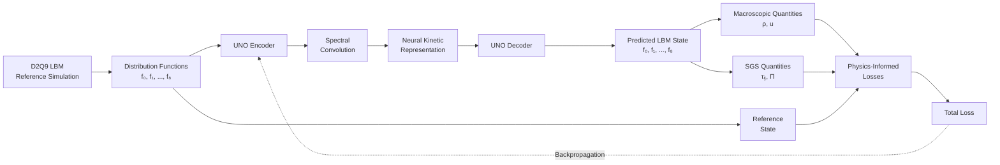

<div align="center">


# Physics-Informed Boltzmann Kinetic Learning for Subgrid-Scale Turbulence Modeling

### PINO-LBM

A unified physics-informed neural-kinetic framework for  
subgrid-scale turbulence modeling within the Lattice Boltzmann Framework.

<br>


</div>

---

# Overview

This repository contains the complete **PyTorch implementation** of the unified physics-informed neural-kinetic framework presented in our paper:

> **Physics-Informed Boltzmann Kinetic Learning for Subgrid-Scale Turbulence Modeling in the Lattice Boltzmann Framework**

Presented at the **Proceedings of the 13th International and 53rd National Conference on Fluid Mechanics and Fluid Power (FMFP 2026)**, December 10–12, 2026, NIT Rourkela, India.

**Paper ID:** `FMFP2026-XX-YYY`

The proposed **PINO-LBM** framework integrates three traditionally separate machine-learning paradigms within a unified Lattice Boltzmann architecture:

1. Collision/operator learning
2. Subgrid-scale stress and energy-transfer modeling
3. Neural operator-based fast-forward prediction

The framework employs a **U-shaped Neural Operator (UNO)** with spectral convolutions and physics-informed losses designed to preserve important physical properties of turbulent flow.

---

# Abstract

Numerical simulations of turbulent flows at high Reynolds numbers remain computationally prohibitive due to the enormous degrees of freedom required. While machine learning has emerged as a transformative tool, existing approaches within the Lattice Boltzmann Method (LBM) remain fragmented across three disjoint paradigms: collision operator learning, subgrid-scale stress prediction, and neural operator-based fast-forward prediction.

This paper presents a **unified physics-informed neural-kinetic framework** integrating these paradigms within a single LBM architecture. The framework employs a **U-shaped Neural Operator (UNO)** with spectral convolutions and physics-informed losses for:

- Moment matching
- Symmetry equivariance
- Subgrid-scale (SGS) energy transfer

Our complete PyTorch implementation is provided in this repository.

Numerical validation on **homogeneous isotropic turbulence** demonstrates superior performance over the classical Smagorinsky model. The neural operator achieves approximately **1.5% relative error in density prediction**, accurately captures the theoretical **$k^{-5/3}$ Kolmogorov scaling**, reproduces anomalous scaling associated with intermittency, and preserves physical backscatter with approximately **15–20% negative energy-transfer events**.

---

# Key Highlights

| Component | Description |
|---|---|
| Neural Architecture | U-shaped Neural Operator (UNO) |
| Numerical Framework | D2Q9 Lattice Boltzmann Method |
| Learning Paradigm | Physics-Informed Neural Operator |
| Spectral Learning | Fourier/Spectral Convolutions |
| Conservation | Mass and Momentum Moment Matching |
| Symmetry | Dihedral Equivariance |
| SGS Modeling | Learned SGS Energy Transfer |
| Density Error | Approximately 1.5% |
| Energy Spectrum | $k^{-5/3}$ Kolmogorov Scaling |
| Intermittency | Anomalous Scaling Reproduced |
| Backscatter | 15–20% Negative Energy Transfer Events |
| Framework | PyTorch |
| License | MIT |

---

# Framework Overview

The complete PINO-LBM framework combines the Lattice Boltzmann Method, neural operators, spectral convolutions, and physics-informed learning into a unified computational architecture.



# Lattice Boltzmann Method

The mesoscopic **Lattice Boltzmann Method (LBM)** characterizes the fluid system through particle distribution functions:

$$
f_i(\mathbf{x}, t)
$$

where $f_i$ represents the particle distribution associated with the discrete velocity $\mathbf{c}_i$ at spatial position $\mathbf{x}$ and time $t$.

For the D2Q9 velocity stencil, the discrete Boltzmann evolution equation is:

$$
f_i(\mathbf{x} + \mathbf{c}_i \Delta t, t + \Delta t)
= f_i(\mathbf{x}, t) + \Omega_i(\mathbf{x}, t)
$$

where $\Omega_i$ represents the collision operator responsible for the local redistribution of particle populations.

The macroscopic density is obtained from the zeroth moment:

$$
\rho
= \sum_{i=0}^{8} f_i
$$

The macroscopic momentum is obtained from the first moment:

$$
\rho \mathbf{u}
= \sum_{i=0}^{8} f_i \mathbf{c}_i
$$

and therefore, the macroscopic velocity is:

$$\mathbf{u} = \frac{1}{\rho} \sum_{i=0}^{8} f_i \mathbf{c}_i$$
----

# U-Shaped Neural Operator

Instead of explicitly evaluating every intermediate collision and streaming step, PINO-LBM learns a direct mapping between an initial LBM state and a future state:

$$
\mathcal{G}:
\{f_i(\cdot, t_0)\}_{i=0}^{8}
\longmapsto
\{f_i(\cdot, t_0 + n\Delta t)\}_{i=0}^{8}
$$

where:

- $t_0$ is the initial time.
- $n\Delta t$ is the prediction horizon.
- $f_i$ represents the D2Q9 distribution functions.
- $\mathcal{G}$ represents the learned neural operator.

This formulation enables the model to predict multiple future time steps without explicitly resolving every intermediate LBM operation.

----
# UNO Architecture

mermaid
```
flowchart TB


    A["Input LBM State<br/>9 Distribution Functions"]

    A --> B["Encoder Block 1"]
    B --> C["Spectral Convolution"]
    C --> D["Encoder Block 2"]
    D --> E["Spectral Convolution"]
    E --> F["Encoder Block 3"]

    F --> G["Latent Neural Operator<br/>Representation"]

    G --> H["Decoder Block 1"]
    H --> I["Spectral Convolution"]
    I --> J["Decoder Block 2"]
    J --> K["Spectral Convolution"]
    K --> L["Decoder Block 3"]

    L --> M["Predicted Future State<br/>9 Distribution Functions"]

    B -. "Skip Connection" .-> J
    D -. "Skip Connection" .-> H
```
Each block combines local convolutional operations with spectral convolution layers to capture both local features and long-range spatial dependencies. The spectral layers transform the feature representations into Fourier space, apply learned complex-valued weights to the relevant frequency modes, and subsequently transform the resulting representations back into physical space.
